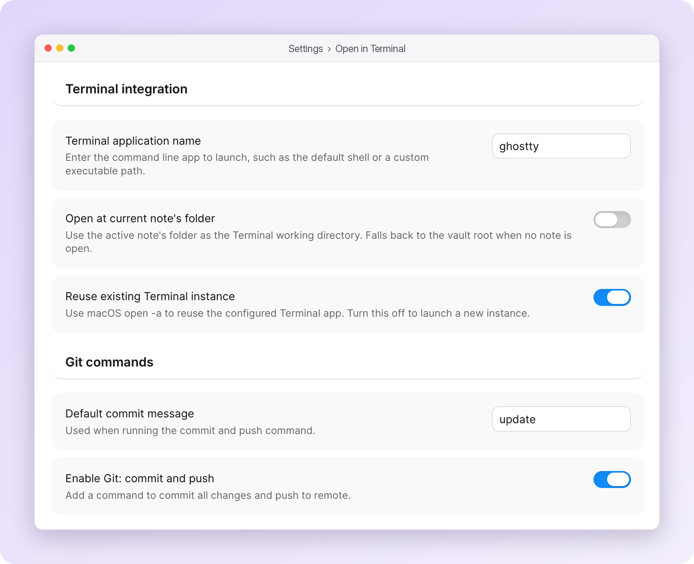

<h1 align="center">Open in Terminal</h1>

  <strong>Open your Obsidian vault in a terminal, or launch Claude Code, Codex, Gemini CLI and other coding agents inside it, straight from the command palette.</strong>

  
  
  
  
  

  <a href="obsidian://show-plugin?id=open-in-terminal"><strong>Install in Obsidian</strong></a> ·
  <a href="https://community.obsidian.md/plugins/open-in-terminal">Plugin page</a> ·
  <a href="CHANGELOG.md">Changelog</a>

<!-- TODO Feng: record assets/demo.gif (6–8 s, ~900 px wide, < 5 MB, light theme, no personal note names).
     Shot list: 1) vault open in Obsidian; 2) Cmd+P, type "claude"; 3) pick "Open in Claude Code";
     4) terminal window appears already in the vault folder with `claude` starting; 5) hold 1 s.
     Optional second clip assets/demo-terminal.gif: "Open in terminal" at the current note's folder.
     When the GIF exists, place: 

 -->

## Why

Your vault is a folder of Markdown files, which is exactly what coding agents and Git work best with. Getting there normally means opening a terminal, finding the vault path and typing `cd`. This plugin turns that into one command, and it can hand the note you are looking at to the agent.

## Features

- **Open the vault in your terminal**: one command opens your terminal at the vault root, or at the folder of the active note.
- **Launch coding agents in your vault**: dedicated commands for Claude Code, Codex CLI, GitHub Copilot, Cursor CLI, Gemini CLI and OpenCode. Turn on only the ones you use.
- **Pass the active note to your agent**: optionally include the current note path in the prompt, with your own prefix and suffix text and a live preview.
- **One-command Git**: `Git: commit and push` and `Git: pull` run from the vault root.
- **Cross-platform**: sensible defaults for macOS, Windows (including WSL) and Linux, stored per platform so a synced vault works on every machine.

## Quick start

1. Install the plugin (see [Installation](#installation)) and enable it.
2. Press `Cmd/Ctrl+P` and run **Open in terminal**.
3. To use an agent, open **Settings → Open in Terminal → Coding agents**, turn on the agent you have installed (for example Claude Code), then run **Open in Claude Code** from the command palette.

> If this saves you a few `cd`s a day, a ⭐ on GitHub is the easiest way to help other Obsidian users find it.

## Installation

**Community plugins (recommended)**
In Obsidian, open **Settings → Community plugins → Browse**, search for **Open in Terminal**, click **Install**, then **Enable**. Or open the [plugin page](https://community.obsidian.md/plugins/open-in-terminal) and click **Add to Obsidian**.

**Manual**
1. Download `main.js` and `manifest.json` from the [latest release](https://github.com/Feng6611/Obsidian-open-in-Teminal/releases/latest).
2. Put them in `<your vault>/.obsidian/plugins/open-in-terminal/`.
3. Reload Obsidian and enable **Open in Terminal** under **Settings → Community plugins**.

<!-- TODO Feng: keep this BRAT block only if you publish pre-releases/betas on GitHub. -->
**Beta versions (BRAT)**
Install [BRAT](https://github.com/TfTHacker/obsidian42-brat), choose **Add beta plugin**, and enter `Feng6611/Obsidian-open-in-Teminal`.

Requires Obsidian 1.5.0 or later, desktop only. Agent and Git commands need the matching CLI (`claude`, `codex`, `git`, …) installed on your system.

## Commands

| Command | What it does |
|---|---|
| **Open in terminal** | Opens your terminal at the working directory |
| **Open in Claude Code** | Runs `claude` |
| **Open in Codex cli** | Runs `codex` |
| **Open in GitHub Copilot** | Runs `copilot` |
| **Open in Cursor cli** | Runs `agent` |
| **Open in Gemini cli** | Runs `gemini` |
| **Open in OpenCode** | Runs `opencode` |
| **Git: commit and push** | Runs `git add . && git commit -m "<default message>" && git push` |
| **Git: pull** | Runs `git pull` |

Except for **Open in terminal**, every command stays off until you enable it in settings.

## Settings

  

- **Terminal application**: the executable name or path, such as `Terminal` or `iTerm` on macOS, `powershell` or `cmd.exe` on Windows, `gnome-terminal` or `alacritty` on Linux. Leave blank for the platform default. Do not include command-line arguments.
- **Open at current note's folder**: uses the active note's folder as the working directory; falls back to the vault root when no note is open.
- **Include current note in prompt**: off by default. When on, coding agents launch with your prefix, the note path and your suffix combined into one prompt. Terminal and Git commands never receive this prompt.
- **Reuse existing terminal instance** (macOS): reuses the running terminal app; turn off to launch a new instance.
- **Coding agents**: toggles for each agent command.
- **Git commands**: default commit message (`update` by default) and toggles for the Git commands.
- **Use WSL for commands** (Windows): runs every configured command inside WSL.

## Platform notes

- **macOS**: Terminal and iTerm are fully supported. Coding agents launch through a temporary `.command` script in a login shell; other terminal emulators must be able to open `.command` files.
- **Windows**: Command Prompt, Windows PowerShell, PowerShell 7, Windows Terminal and Tabby, with or without WSL.
- **Linux**: requires Bash. GNOME Terminal and terminals that accept the `-e` flag work out of the box.

## FAQ

**I don't see "Open in Claude Code" in the command palette.**
Agent and Git commands are off by default. Turn them on in **Settings → Open in Terminal**.

**The agent command opens a terminal but nothing runs.**
The CLI must be installed and on your login shell's `PATH`. Run `claude --version` (or the matching command) in a normal terminal first.

**Does the plugin send my notes anywhere?**
No. The plugin makes no network requests of its own. Only an optional note *path*, never note contents, can be passed to an agent prompt. Whatever the agent or CLI does after launch is up to that tool.

**Does it skip the agent's permission prompts?**
No. The plugin never bypasses CLI confirmation prompts or permission checks.

## Permissions and disclosures

This plugin is `isDesktopOnly: true` and needs two desktop capabilities that automated review may flag. Both are required for the product to work; they are scoped as follows.

### Shell execution (`child_process`)

Commands are started with Node `spawn` and **`shell: false`**. The executable is one of:

- the terminal application name or path you configure in settings (validated to reject empty values and control characters; not a fixed allowlist, so custom terminals keep working);
- a fixed CLI agent command such as `claude`, `codex`, `copilot`, `agent`, `gemini`, or `opencode`;
- a `git` probe (`git rev-parse`) used only to detect whether the vault is a Git repository.

The working directory is the vault root, or, when enabled, the folder of the active note **after** resolving the path and confirming it still lies inside the vault. Paths that would escape the vault fall back to the vault root.

### Direct filesystem access (`fs`)

On macOS and Windows the plugin writes a short-lived launch script (`.command` / `.ps1`, mode `0700`) under a fresh directory in the OS temp folder, then deletes that directory after launch (or on failure). This is outside the vault because the system terminal APIs need a real script path; the Obsidian Vault API cannot substitute for it.

The plugin does **not**:

- read or write vault note contents via `fs`;
- walk your home directory or other arbitrary paths;
- make network requests of its own (any network activity comes only from the terminal or CLI tools you choose to run);
- put note body text into launch scripts (only an optional note **path** may be passed into an agent prompt).

See also Obsidian's [Developer policies — Disclosures](https://github.com/obsidianmd/obsidian-developer-docs/blob/31946e5a/en/Developer%20policies.md) for vault-external file access.

## Privacy

This desktop-only plugin launches programs on your local machine: it opens your terminal emulator and runs the commands you configure. On macOS and Windows it writes a temporary script outside the vault and deletes it after launch; on Windows that script runs under a process-scoped execution policy without changing system-wide policies. `Git: commit and push` stages all files under the vault root before committing.

## Support the project

Open in Terminal is free and MIT-licensed. If it's part of your daily workflow:

- ⭐ **Star the repo**: it costs nothing and helps other people find the plugin.
- ☕ **[Buy me a coffee](https://buymeacoffee.com/kkuk)**: helps keep updates coming.
- 🐛 **[Report a bug or request a feature](https://github.com/Feng6611/Obsidian-open-in-Teminal/issues)**: issues with your OS, terminal and agent are the most useful.

<!-- TODO Feng: if you enable GitHub Sponsors, add: "💜 [Sponsor on GitHub](https://github.com/sponsors/<TODO>)" as the first money option. -->

## More from the author

Built by [chenfeng](https://github.com/Feng6611).

- [File Ignore](https://github.com/Feng6611/Obsidian-File-Ignore): keep `node_modules`, build output and other non-note folders out of Obsidian's index.
- [Command Reopen](https://commandreopen.com): a small Mac utility that makes Cmd+Tab restore minimized windows.

## License

[MIT](LICENSE)
